<a href="https://monkeytype.com/profile/Kyziq">
  <picture>
    <source media="(prefers-color-scheme: dark)" srcset="assets/hero-dark.svg">
    
  </picture>
</a>

Platform and full-stack engineer at Telekom Malaysia's AI Centre of Excellence. Founding Engineer at [LearnifAI](https://app.learnifai.my).

Lately I've been:

- building Ramai with my team, first place in the Advanced category of TM's AI Elevate Hackathon
- building the AI assistant on [TM's 2025 Integrated Annual Report](https://www.tm.com.my/iar2025/)
- shipping AI-scored games and running them live at TM events
- looking after the infrastructure under all of it, from Ansible to TLS

Merged into [Zod](https://github.com/colinhacks/zod/pull/4204), [Better Auth](https://github.com/better-auth/better-auth/pull/10114), [TanStack Router](https://github.com/TanStack/router/pull/2377), [T3 Code](https://github.com/pingdotgg/t3code/pull/21055) and [HeroUI Native](https://github.com/heroui-inc/heroui-native/pull/102).

Mostly TypeScript and Python: React, TanStack, Hono, FastAPI, PostgreSQL, Kubernetes.
